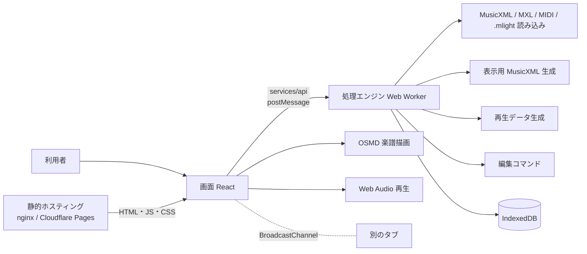
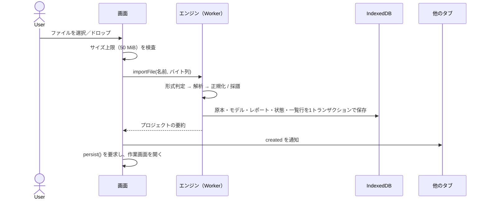
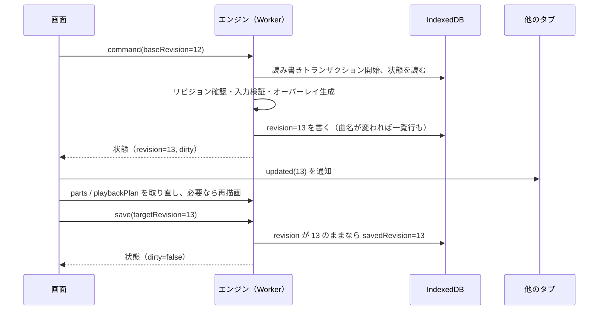

# MLightNote アプリケーション仕様書

| 項目 | 内容 |
|---|---|
| 文書ステータス | 1.0（現行実装に合わせた改訂版） |
| 初版 | 2026-09-22（Draft 0.1：React＋Go API＋Docker 構成での実装開始用ベースライン） |
| 改訂 | 2026-09-25（フロントエンド完結化とミキサー追加を反映し、全章を現行実装に合わせて書き直し） |
| 対象プロダクト | ブラウザだけで動くフルバンド向け楽譜ビューアー／軽量エディター／MIDIプレイヤー |
| 名称 | MLightNote |
| 独自ファイル拡張子 | `.mlight` |

> 本書の読み方：各章は「仕様（あるべき姿）」と「現状」を分けて書く。**現状** と明記した箇所が実装の事実であり、それ以外は要求仕様である。要求のうち未実装のものは §0.3 と各章の「未実装」に列挙する。章番号はソースコードのコメントから参照されているため、番号は初版から変えていない（内容が変わった章は見出しで示す）。

## 0. 実装状況（随時更新）

> このセクションは実装の進行に合わせてコミットごとに更新する。「何ができていて何ができていないか」を常に正確に保つことを目的とし、別の状況管理ファイルは置かず本書に一本化する。

最終更新: 2026-11-03

### 0.1 現在の構成と進捗

- **構成：** 静的サイト（HTML・JavaScript・CSS のみ）。楽譜の読み込み・MIDI採譜・表示用 MusicXML の生成・再生データの生成・編集・保存は、すべて利用者のブラウザ内（Web Worker と IndexedDB）で行う。サーバー側のプログラムは無い。
- **配信：** ローカル確認は `make deploy`（nginx の静的コンテナ、http://127.0.0.1:8080）。本番ビルドは静的ファイルだけで、どの静的ホスティングにも置ける（パスの下にも置ける。手順は [docs/DEPLOY.md](docs/DEPLOY.md)）。作者の公開サイトの構成と公開作業は、このリポジトリの外（非公開の配信用リポジトリ）で管理する。
- **ライセンス：** MIT（[LICENSE](LICENSE)）。同梱する第三者ソフトウェアのライセンスは、ビルド時に `third-party-licenses.txt` として出力し、マニュアルからリンクする（§20.3）。
- **経緯：** 初版は React＋Go API＋Docker（ファイルベースの保存）で実装し、M1〜M7 を完了した。一般公開に向けて Go の処理を TypeScript に移植し、Go を削除した（[docs/history/FRONTEND_MIGRATION_PLAN.md](docs/history/FRONTEND_MIGRATION_PLAN.md)）。移植の正しさは、Go 版の出力を固定した正解データとの一致テストで保証している（§19.5）。

| 領域 | 状態 | 主な内容 |
|---|---|---|
| 読み込み | ✅ | MusicXML（`.xml` `.musicxml`、score-partwise）、`.mxl`、MIDI（SMF Format 0/1、PPQ）、`.mlight`。形式は拡張子ではなく中身で判定 |
| MIDI採譜 | ✅（固定設定） | 1/16量子化＋拍ごとの3連符判定、和音化、小節をまたぐタイ、休符補完、調号の読み取りと推定、調に沿った音名、連桁、トラック×チャンネルでのパート分け、2トラックの大譜表統合、ドラム譜、テンポ |
| 表示 | ✅ | OSMD による五線譜、フルスコア／単一／任意の複数パート、実音表示、ズーム25〜400%、パート名ラベル、2段目以降の略称、反復記号、記譜要素（スラー・連符・装飾・歌詞・強弱など） |
| 再生 | ✅ | 再生・一時停止・停止・シーク、再生カーソルと自動追従、小節クリックでシーク、A-Bループ、テンポ25〜200%、メトロノーム、反復の展開、強弱とアーティキュレーション、内蔵シンセ（GM 128音色）とドラム |
| ミキサー | ✅ | 画面下部の開閉式ミキサー（フェーダー、パン、M/S、レベルメーター、マスター、一括操作） |
| 印刷 | ✅ | 印刷プレビュー、A4／Letter、縦／横、譜表サイズ、余白、ページ番号、ヘッダー／フッター、ブラウザ印刷・PDF保存 |
| 編集 | ✅ | 曲情報、パート名・略称・音色・音量・パン・ミュート・ソロ・表示／印刷対象・移調（記譜）・並び順。元に戻す／やり直す（100段）、リビジョン競合の検出 |
| 保存 | ✅ | 編集ごとにブラウザ内へ保存、`.mlight` のダウンロードと読み込み（Go 版で作ったものも可）、プロジェクト一覧・削除、複数タブの同期 |
| 診断 | ✅ | インポートレポート（警告コード、元ファイルの SHA-256） |
| 配信 | ✅ | ローカルの静的配信（Docker＋nginx）、任意の静的ホスティングへの配信（パスの下も可）、第三者ライセンス一覧の同梱、CI（GitHub Actions） |

テスト（2026-11-03 時点）：Vitest 160件（Go 版との一致テストを含む）、E2E 22件（Playwright、開発サーバー。実在の曲が無い環境では 12件がスキップされ 10件）、本番ビルドのスモークテスト2件（nginx＋CSP）。すべて成功。CI（GitHub Actions）で同じものを実行する。

### 0.2 機能別チェックリスト（§22 の要約）

- [x] MusicXML／MXL／MIDI／`.mlight` を読み込んで五線譜で表示できる
- [x] 推定・修復をインポートレポートで確認できる
- [ ] MIDI採譜設定（量子化・分割点など）を確定前にプレビューで変えられる（固定設定のみ）
- [x] フルスコア／単一パート／任意の複数パートの切替、記譜音／実音の切替
- [x] 再生・シーク・A-Bループ・テンポ倍率・メトロノーム・再生カーソル
- [x] パートごとの mute／solo／volume／pan／音色、ミキサー画面
- [x] 印刷プレビューと出力のページ数一致
- [x] 軽量編集、undo／redo、リビジョン競合の検出
- [x] `.mlight` の保存・再オープンで編集内容と原本が一致
- [x] 偽装ファイル・zip-slip・zip bomb・改ざんパッケージの拒否
- [x] 読み込み後に外部サーバーへの通信が0件（E2E で検証）
- [ ] ページ仮想化（巨大スコアの部分描画）
- [ ] WCAG 2.2 AA の体系的な監査

### 0.3 既知の未実装・簡略化箇所

**読み込み・採譜**
- MIDI採譜は固定設定（1/16量子化、拍単位の3連8分判定、1段1声部、付点は1つまで）。設定UI、スウィング判定、ピアノ分割点の手動指定、大譜表統合の手動選択、3連16分・5連符、8分の6拍子系の3連判定は未実装。跳ねた8分は「3連4分＋3連8分」として記譜される。
- MIDIは1段1声部を仮定する。重なって鳴る音は後の音の開始位置で切り、同時に始まる長さの違う音はタイで分けて記譜する（多声部への振り分けは無い）。
- MIDIの記譜タイムラインと演奏タイムラインの分離（§9.6）は未実装。再生は量子化後の記譜から生成する。元のバイト列は保持している。
- MusicXML は score-partwise のみ（score-timewise は未対応）。取り込んだ要素以外は正規化モデルに残らず、原本のバイト列としてだけ保持する（`SourceReference` と未知要素の原文保持は未実装）。
- 取り込み時の上限はファイル 50 MiB、展開後 200 MiB、ZIP エントリ 1,000、XML の深さ 256、MIDI の小節数 20,000。正規化イベント数・パート数の上限は未実装。

**表示・印刷**
- ページ仮想化は無い（全ページを描画する）。停止中にパートを切り替えたときの小節位置の維持は無い（再生中は追従で戻る）。
- パートごとに改ページして全パート譜を一括印刷する機能、余白の mm 指定、印刷設定の保存は未実装。
- UI／譜面用フォントを同梱していない。日本語フォントの無い環境では曲名などが □ になる。

**再生**
- 音源は内蔵シンセ（倍音・フィルタ・エンベロープで GM 128音色を近似）で、実楽器のサンプルではない。
- ヘアピンによる段階的な音量変化、フェルマータの伸長、装飾音の前打ちは再生に反映しない。sustain・pitch bend などのコントローラーは読み込まない。
- A-Bループは小節単位。テンポ倍率・メトロノーム・ループ・マスター音量は保存されない。
- 再生カーソルは小節内を時間で線形補間する（音符には吸着しない）。反復の展開は小節単位。

**編集・保存**
- パートグループ、MIDI チャンネル／バンクの編集、表示・印刷・再生設定の保存は未実装。
- `.mlight` の settings エントリ（§10.1）とスキーマ移行の仕組みは未実装（現在は v1 のみ）。
- 保存先はそのブラウザの IndexedDB だけ。別の端末・ブラウザとの同期は無く、閲覧データの削除で消える（`navigator.storage.persist()` を要求し、`.mlight` でのバックアップを案内している）。
- `.mlight` を読み込んだとき、未知の任意エントリはブラウザ内の保存領域へ持ち越さない（パッケージの読み書き自体は保持する）。
- 「別名で保存」「複製」は未実装。
- URL にプロジェクトが対応していない（再読み込みするとホームに戻る）。
- 初版のサーバー版で作ったプロジェクト（Docker のボリュームに保存）は自動では移らない。`main` ブランチ版で `.mlight` をダウンロードして読み込む。

**その他**
- `Pitch.Alter` は整数（微分音は保持しない）。
- 警告コードのうち実際に出すのは `INFERRED` と `REPAIRED`。`UNSUPPORTED_PRESERVED`・`IGNORED_FOR_RENDERING` は型のみ、`IGNORED_FOR_PLAYBACK`・`REJECTED` は未定義。
- WCAG 2.2 AA の体系的な監査、譜面の音符単位のテキスト代替（§14.4）は未実装。
- Safari とスマートフォンは動作未確認。
- 実在の曲を使う E2E テスト（長い楽譜の描画・印刷のページ数・MIDI 採譜・トランスポートなど）は、楽譜がリポジトリに無いため CI ではスキップされる。自作またはパブリックドメインの楽譜への置き換えは未実施（§21.2）。
- 性能基準（§17.2）は未計測。

### 0.4 変更履歴（要約）

詳細は git の履歴を参照。

| 日付 | 内容 |
|---|---|
| 2026-09-22 | 初版仕様（React＋Go API＋Docker）。旧プロトタイプは `archive/v0-prototype` ブランチへ退避 |
| 2026-09-23 | M1〜M7：OSMD による五線譜表示、MusicXML／MIDI の取り込みと表示用 XML 生成、再生（反復・テンポ・強弱）、パート表示と印刷、軽量編集と `.mlight`、セキュリティ、E2E。利用者報告による修正（MIDI の連桁と調推定、音色、`<backup>` の行き過ぎによる再生のずれ、プロジェクト削除、トラック×チャンネルのパート分け、ドラム譜、読みにくい音部記号変更の抑制、UI 刷新、楽章名の編集、パート略称とラベル、使い方マニュアル、パートの移調設定、`make deploy`） |
| 2026-09-25 | フロントエンド完結化（段階0〜6）：Go の処理を TypeScript へ移植し、Go 版の出力との一致をテストで固定。IndexedDB 保存、Web Worker、複数タブ同期、静的配信。移植中に Go 版の非安定ソートによる出力の揺れを発見・修正。Go の削除 |
| 2026-09-25 | ミキサー画面（フェーダー・メーター・一括操作、`part.updateMany`）。仕様書の全面改訂、`BASE.md`（最初の依頼文）の削除、Cloudflare Pages 公開手順書と `_headers` |
| 2026-11-02 | 公開先を `https://toolsonbrowser.com/mlightnote/` に決定。Pages の独自ドメインはパスの下に割り当てられないため、Pages（Direct Upload）＋ルート `toolsonbrowser.com/mlightnote*` の振り分け用 Worker（`cloudflare/router/`）の構成にした。ビルドのパスを `MLIGHTNOTE_BASE` で切り替えられるようにし、公開スクリプト `make publish`（`scripts/publish-cloudflare.sh`）、`_headers` の書き換えと `_redirects` の生成（`scripts/cloudflare/`）、その単体テスト、`wrangler` 4.150.0（開発用）を追加。スモークテストを `/` 以外のパスでも動くように修正。手順書をアカウント作成からの全手順に書き直し |
| 2026-11-03 | OSS として公開するための整理。MIT ライセンス、`SECURITY.md`、CI（`.github/workflows/ci.yml`）を追加。ビルド時に第三者ライセンス一覧 `third-party-licenses.txt` を出力し（`web/thirdPartyLicenses.ts`）、マニュアルにリンクを追加。著作権のある実在曲（`samplefiles/`）と、それから作った正解データ（旧 05〜07 の 3 曲分）をリポジトリから外した（正解データの削除はテスト対象の縮小で、エンジンの挙動は変えていない）。スモークテストは `testdata/` の楽譜を使うようにした。Cloudflare への公開スクリプトと振り分け用 Worker は、作者の非公開の配信用リポジトリへ移すためにここから削除し、公開先を問わない配信手順書 [docs/DEPLOY.md](docs/DEPLOY.md) に置き換えた。個人用の設定（エージェントのフック、作業手順）は Git の管理から外した |
| 2026-11-03 | 依存の一括更新（Dependabot の #7〜#15 をまとめて検証）：react・react-dom 19.3.1（別々に上げると版がずれて React が動かないため同時に）、opensheetmusicdisplay 2.2.1、TypeScript 7.0.2、vite 8.3.5、vitest 5.0.5 ほか開発用 8件、source-map-js 1.2.2、GitHub Actions（checkout・setup-node・upload-artifact v7）。分けて更新すると lock ファイルに古い `@vitest/coverage-v8` が残り、`npm ci` で `vitest` が最上位に入らなかったため、`npm dedupe` で整理した。Dependabot に react 系のグループ化と、公開から 7 日の待ち期間を設定 |
| 2026-11-03 | vite を 8.3.3 に更新（8.3.0〜8.3.2 の脆弱性への対応）。Dependabot がワークスペースの最上位のロックファイルを更新するよう `.github/dependabot.yml` を追加（`/web` を見ると `package-lock.json` が更新されず、`npm ci` が失敗するため） |
| 2026-11-03 | Playwright を 1.55.0 から 1.64.1 に更新（1.55.1 未満の脆弱性への対応）。CI の実行環境の固定（`ubuntu-24.04`）を外し、`ubuntu-latest` に戻した |
| 2026-11-03 | E2E テストが探す実在の曲を、曲名ではなく役割の名前（`score.xml`、`score.mid`、`band.mid`）で探すようにした。サブタイトルの編集テストは、特定の文字列ではなく読み込んだ値を使う。CI の実行環境を `ubuntu-24.04` に固定（Playwright 1.55 が Ubuntu 26.04 に対応していないため） |

## 1. 文書の目的

本書は、MIDI または MusicXML から楽曲を読み込み、フルスコアとパート譜の閲覧・印刷・再生・軽量編集・独自形式保存を行うアプリケーションの仕様を定義する。

本書を、プロダクト要件、画面、データモデル、処理エンジンの操作、保存形式、セキュリティ、テスト、配信の基準文書とする。仕様を変える場合は、実装と同じ変更で本書を更新する。

## 2. プロダクト定義

### 2.1 解決する課題

フルバンド向けの MIDI や MusicXML を受け取った利用者が、重い DAW や本格的な楽譜制作ソフトを入れなくても、次の作業をブラウザだけで完結できるようにする。

1. 曲全体と各パートを素早く確認する。
2. 総譜またはパート譜を読みやすく印刷する。
3. 音色やパートバランスを整え、譜面どおりに試聴する。
4. 曲名、クレジット、パート名、表示順、音色などを整える。
5. 元データとアプリ固有の設定を失わずに保存し、後日同じ状態で再開する。

### 2.2 想定利用者

- バンドマスター、指揮者、編曲者
- 吹奏楽、ビッグバンド、軽音楽、室内楽などの奏者
- DAW で MIDI を作成し、配布・確認用の譜面が必要な制作者
- MusicXML で受け取った譜面を閲覧・試聴・印刷したい利用者

### 2.3 プロダクト原則

- **ローカルファースト：** 楽譜ファイルは利用者のブラウザの外へ出ない。アカウント、サーバー側の処理、外部 API を必要としない。
- **原本を失わない：** 取り込んだファイルは不変の原本としてバイト列のまま保持し、アプリ内の編集は差分（オーバーレイ）として管理する。
- **MusicXML 優先：** 正確な記譜が必要な場合は MusicXML を推奨する。MIDI からの譜面は推定結果として扱う。
- **軽量編集に集中：** 音符を一から入力する用途ではなく、既存データの閲覧、印刷、再生、整理を高品質に行う。
- **失敗を明示：** 推定・修復した内容をインポートレポートに表示し、黙って変えない。
- **再現可能：** 保存後に同じ譜面、編集内容、警告を復元できる。

## 3. スコープ

### 3.1 MVP（P0）

| # | 機能 | 現状 |
|---|---|---|
| 1 | SMF MIDI Format 0/1、MusicXML 3.1/4.0 の読み込み | ✅ |
| 2 | 非圧縮 MusicXML と圧縮 MusicXML（`.mxl`） | ✅ |
| 3 | MIDI 読み込み時のトラック／チャンネル／量子化設定 | 🟡 自動（固定設定）のみ |
| 4 | フルスコア、単一パート、任意の複数パートの表示 | ✅ |
| 5 | ページ表示、ズーム、パート切替 | ✅（連続表示・ページ送りキーは未実装） |
| 6 | 総譜、単一パート、選択パートの印刷と PDF 保存 | ✅ |
| 7 | 再生、一時停止、停止、シーク、範囲ループ、テンポ倍率、メトロノーム | ✅ |
| 8 | パート単位の mute、solo、volume、pan、GM 音色 | ✅（ミキサー画面を含む） |
| 9 | 曲情報、パート情報の軽量編集 | ✅（表示／印刷／再生設定の保存は未実装） |
| 10 | undo／redo、未保存状態の表示、破棄確認 | ✅ |
| 11 | `.mlight` 形式による保存、再オープン、整合性検証 | ✅（スキーマ移行は未実装） |
| 12 | インポート警告、エラーの表示 | ✅ |
| 13 | 静的サイトとしての配信（ブラウザだけで全機能が動く） | ✅（初版の「Docker Compose による一括起動」から変更） |

### 3.2 MVP後（P1）

- 全パート一括の印刷・PDF 化、パート譜 PDF の ZIP 出力
- MIDI 採譜設定の UI（量子化、スウィング、分割点、パート分けの手動指定）
- 手動改ページ、譜めくり位置の調整
- SoundFont など実楽器音源、カウントイン、MIDI 出力デバイス
- MusicXML／MIDI への再エクスポート
- 注釈、色、運指など、音符を変えない付加情報の編集
- MusicXML `score-timewise`、SMPTE division、SMF Format 2
- PWA（インストールと完全オフライン起動）、URL によるプロジェクトの共有リンク
- 表示・印刷・再生設定のプロジェクト保存

### 3.3 対象外

- 音符、休符、和音を自由に追加・削除する本格的な浄書機能
- DAW 相当のピアノロール、録音、オーディオ波形、オートメーション、プラグイン
- 自動編曲、リアルタイム共同編集、クラウド同期、アカウント
- スマートフォンでの本格編集
- MusicXML 全要素および全ベンダー固有表現の 100% 再現保証

## 4. 重要な仕様上の前提

### 4.1 MIDI と楽譜の違い

MIDI には発音時刻、音高、強さ、音色などの演奏情報はあるが、異名同音、声部、連桁、タイ、スラー、装飾、改ページ、パートグループなどの記譜情報が原則として無い。そのため、MIDI から作る譜面は量子化と推定に基づく。

推定した内容（調号の推定、パートの分け方、大譜表への統合）はインポートレポートに `INFERRED` として記録し、利用者が確認できるようにする。

### 4.2 「すべてのメタデータを保持」の定義

`.mlight` 形式で次を保存できることを指す。

| # | 内容 | 現状 |
|---|---|---|
| 1 | 取り込んだファイルの完全なバイト列と SHA-256 | ✅ |
| 2 | MIDI／MusicXML から解釈した正規化スコアモデル | ✅ |
| 3 | 元ファイル内の位置と正規化エンティティの対応 | 未実装 |
| 4 | 未解釈要素、ベンダー拡張、SysEx 等 | 原本のバイト列としてのみ保持 |
| 5 | アプリ内の編集差分 | ✅ |
| 6 | 表示、印刷、再生、インポートの設定 | 未実装 |
| 7 | インポートレポートと警告 | ✅ |
| 8 | ファイル形式とアプリのバージョン | ✅ |

元形式への再エクスポートは保証対象外とする。原本の完全保持と、MLightNote 内の作業状態の復元を保証対象とする。

### 4.3 ローカル動作の定義（改訂）

- アプリは静的ファイル（HTML・JavaScript・CSS）として配信する。配信元は、ローカルの nginx コンテナでも公開ホスティングでもよい。
- 楽譜の処理はすべてブラウザ内で行い、楽譜ファイルや編集内容をどこにも送信しない。
- 読み込み後の実行中に、CDN、テレメトリー、アクセス解析、外部フォント、外部 API へ接続しない（E2E で検証、§17.4）。
- JavaScript、アイコン、音源（内蔵シンセ）は配布物に含める。フォントは OS のものを使う（同梱は未実装）。
- データはブラウザの IndexedDB に置く。ホスト上のパスは扱わず、出し入れはファイル選択とダウンロードだけで行う。
- アプリの読み込み自体にはネットワークが必要（PWA ではない）。

## 5. ユーザーストーリーと受け入れ条件

| ID | ユーザーストーリー | 主な受け入れ条件 | 現状 |
|---|---|---|---|
| US-01 | MIDI を読み込みたい | 有効な Format 0/1 を開くと、テンポ、拍子、パート、警告を反映したスコアが開く。失敗時に既存プロジェクトを変更しない。 | ✅（設定の事前確認は無い） |
| US-02 | MusicXML/MXL を読み込みたい | パート順と対応要素を維持して表示し、推定・修復を報告する。元ファイルを完全に保持する。 | ✅ |
| US-03 | 指揮者として総譜を確認したい | 全表示対象パートを同時に閲覧でき、ズームや実音／記譜音を切り替えられる。 | ✅ |
| US-04 | 奏者として自分のパートを確認したい | プロジェクトを読み直さずにパートを切り替えられる。複数譜表の楽器は1つのパートとして表示する。 | ✅（小節位置の維持は再生中のみ） |
| US-05 | 総譜やパート譜を印刷したい | プレビューと出力のページ構成が一致し、UI を含まず、音符や文字が欠けない。 | ✅ |
| US-06 | 譜面を聴いて確認したい | 再生、一時停止、停止、シーク、ループが動作し、停止時に発音が残らない。カーソルが追従する。 | ✅ |
| US-07 | 表示名や音色を整えたい | 編集が表示／再生へ反映され、undo／redo でき、未保存状態が明示される。無効値は拒否される。 | ✅ |
| US-08 | 作業状態を持ち運びたい | `.mlight` を別のブラウザで開いても、スコア、編集値、パート順、警告が同一で、原本 SHA-256 が一致する。 | ✅ |
| US-09 | 問題を診断したい | 形式、警告コード、対象パート／小節を確認できる。 | ✅ |
| US-10 | 全パートの音量バランスを一度に整えたい | 全パートのフェーダーを並べて操作でき、動かしている間も音に反映される。 | ✅ |

## 6. 画面とナビゲーション

### 6.1 画面一覧（改訂）

URL によるルーティングは持たない（1ページのアプリで、状態に応じて表示を切り替える）。

| 画面 | 用途 | 実装 |
|---|---|---|
| ホーム | ファイルの読み込み（ドロップ／選択）、プロジェクト一覧（絞り込み・並べ替え・削除）、保存場所とバックアップの案内、使い方マニュアル | `features/import`、`features/library`、`features/help` |
| 作業画面 | 譜面の閲覧、表示設定、再生、ミキサー、インスペクターでの編集、保存、ダウンロード | `features/workspace` ほか |
| 印刷プレビュー | 用紙・向き・譜表サイズ・余白・ページ番号・ヘッダー／フッターの設定、全ページの確認、印刷 | `features/printing`（作業画面の上に重ねて表示） |
| インポートレポート | 警告の一覧、元ファイルの形式・サイズ・SHA-256 | `features/reports`（ダイアログ） |

### 6.2 作業画面

デスクトップ幅 1280px 以上を正式対象とする。

```text
┌────────────────────────────────────────────────────────────────────┐
│ ヘッダー: ロゴ（一覧へ） / テーマ切替                                   │
├────────────────────────────────────────────────────────────────────┤
│ 曲名 [保存状態]    元に戻す / やり直す / 保存 / レポート / .mlight / 閉じる │
├──────────────────────────────────────────────────┬─────────────────┤
│ 表示設定バー: パート選択 / 実音 / 追従 / ラベル / ズーム / 印刷 │ インスペクター  │
│                                                  │  曲情報         │
│   パート名ラベル │        譜面（紙面）              │  パートごとの   │
│                 │   小節ハイライト＋再生カーソル     │  名前・略称・音色 │
│                                                  │  移調・ミキサー  │
├──────────────────────────────────────────────────┴─────────────────┤
│ ミキサー（開閉式）: チャンネル × パート数 ＋ マスター / 一括操作          │
│ トランスポート: ■ ▶ 時間 シーク ミキサー / テンポ メトロノーム A-B ループ 音量 │
└────────────────────────────────────────────────────────────────────┘
```

- 楽譜の紙面はライト／ダークどちらのテーマでも白。
- トランスポートとミキサーは画面下部に固定する。
- ミキサーはトランスポートのボタンまたは `X` キーで開閉し、開閉状態をブラウザに記憶する。

### 6.3 基本操作

- 表示設定バーのパート選択で、フルスコア／単一パート／任意の複数パートを切り替える（全選択・全解除はフルスコアに戻す）。
- 譜面上の小節クリックで、その小節の頭へ再生位置を移す。
- 再生中にパートや表示を切り替えても再生を続ける。
- 編集はインスペクターまたはミキサーで行い、確定したものを1回の編集として記録する（入力欄は離れたとき／Enter、スライダーは手を離したとき）。
- 保存中も閲覧と再生を妨げない。

### 6.4 キーボードショートカット（改訂）

| 操作 | Windows/Linux | macOS | 現状 |
|---|---|---|---|
| 再生／一時停止 | `Space` | `Space` | ✅ |
| 停止（先頭へ） | `Shift+Space` | `Shift+Space` | ✅ |
| 前／次の小節 | `Left` / `Right` | `Left` / `Right` | ✅ |
| 曲頭／最後の小節 | `Home` / `End` | `Home` / `End` | ✅ |
| ループ切替（未設定なら現在の小節） | `L` | `L` | ✅ |
| メトロノーム切替 | `M` | `M` | ✅ |
| ミキサーの開閉 | `X` | `X` | ✅ |
| 保存 | `Ctrl+S` | `Cmd+S` | ✅ |
| 元に戻す／やり直す | `Ctrl+Z` / `Ctrl+Shift+Z` | `Cmd+Z` / `Cmd+Shift+Z` | ✅ |
| 印刷 | `Ctrl+P` | `Cmd+P` | 未実装（ブラウザ標準の印刷になる） |
| 前／次のページ、ズーム | `PageUp` / `PageDown`、`Ctrl++` / `Ctrl+-` | 同左 | 未実装 |

入力欄にフォーカスがある間は、保存／undo／redo 以外のショートカットを発火させない。ショートカットは使い方マニュアルに一覧する。

## 7. 機能要件

### 7.1 インポート共通

#### FR-IMP-001 対応ファイル

`.mid` `.midi`、`.xml` `.musicxml`、`.mxl`、`.mlight`。

拡張子ではなく中身で判定する（現状の順序：先頭 `MThd` → MIDI、ZIP で先頭エントリが `mimetype` → `.mlight`、ZIP で `META-INF/container.xml` あり → `.mxl`、先頭 4 KiB に `<score-partwise` → MusicXML、それ以外は `IMPORT_UNSUPPORTED_FORMAT`）。

#### FR-IMP-002 インポート方式

- ファイル選択とドラッグ＆ドロップを提供する。一度に読み込めるのは1ファイル。
- 解析は Web Worker で行い、画面を止めない。
- 失敗時はプロジェクト一覧を変更しない（解析が成功してから、1つのトランザクションで保存する）。
- 同じファイルを再度読み込んでも別プロジェクトとして扱う。
- 曲名が無いファイルは、ファイル名（拡張子を除く）を曲名にする。
- 未実装：進捗段階の表示、MIDI 設定の確定前プレビュー（初版の二段階インポートジョブ）。

#### FR-IMP-003 インポートレポート

警告は `info`、`warning`、`error` の重大度と、安定した機械判定コード、対象パート、小節、対象要素を持つ。

| コード | 意味 | 現状 |
|---|---|---|
| `INFERRED` | 情報不足のため推定した（調号、パート名、大譜表統合、チャンネルごとのパート分け、小節番号の振り直し） | 出力している |
| `REPAIRED` | 不整合を安全な規則で修復した（`<backup>` の行き過ぎ） | 出力している |
| `UNSUPPORTED_PRESERVED` | 解釈しないが原文を保持した | 型のみ |
| `IGNORED_FOR_RENDERING` | 表示には使わない | 型のみ |
| `IGNORED_FOR_PLAYBACK`、`REJECTED` | 再生に使わない、安全上拒否した | 未定義 |

#### FR-IMP-004 上限

| 対象 | 上限 | 現状 |
|---|---|---|
| 入力ファイル | 50 MiB（読み込み前に `File.size` で判定し、エンジンでも再確認） | ✅ |
| ZIP（`.mxl`・`.mlight`）の展開後合計 | 200 MiB | ✅ |
| ZIP エントリ数 | 1,000 | ✅ |
| ZIP の圧縮率 | 200倍 | ✅ |
| XML の要素の深さ | 256 | ✅ |
| MIDI の小節数 | 20,000 | ✅ |
| 表示用 XML で指定できるパート数 | 100 | ✅ |
| 反復展開後の長さ | 記譜の16倍 | ✅ |
| 正規化イベント数、パート数、小節数（MusicXML） | 200万、100、2,000 | 未実装 |

### 7.2 MusicXML インポート

#### FR-XML-001 対応範囲

MusicXML 3.1/4.0 の `score-partwise` を対応する。`.mxl` は `META-INF/container.xml` の最初の rootfile を正本とする。

対応している要素：曲名・楽章名・作曲者等、part-list（パート名・略称・part-group）、複数譜表・複数声部、clef・key・time・divisions・transpose、note・rest・chord・dot・accidental・tie・beam・stem、連符（time-modification と括弧）、スラー、装飾音、アーティキュレーション、装飾記号、フェルマータ、アルペジオ、歌詞、コードネーム（degree を含む）、強弱記号、ヘアピン、ペダル、オクターブ記号、テンポ、リハーサルマーク、barline・repeat・ending・segno・coda・D.C.・D.S.・Fine、打楽器（unpitched・notehead・instrument・midi-unpitched）、midi-instrument（音色）。

現状の補正：
- `<backup>` が小節の頭より前へ戻る場合は小節の頭で止め、パートごとに1件の `REPAIRED` を記録する（他の MusicXML リーダーと同じ扱い）。
- 小節番号の大半が重複するファイルは先頭から振り直し、`INFERRED` を記録する。
- 空の part-name は内部 ID ではなく推定した名前で表示し、`INFERRED` を記録する。

未実装：score-timewise、system/page break・page layout の反映、multi-measure rest、テキストの書式。

#### FR-XML-002 保持方針

- 元の XML／MXL は改変せずに保存する。
- 外部 URL で参照された画像、音源、DTD、schema は取得しない。
- 未実装：正規化エンティティごとの `SourceReference`、未対応要素の原文保持（現状は原本のバイト列としてだけ残る）。

### 7.3 MIDI インポート

#### FR-MIDI-001 対応範囲

Standard MIDI File Format 0/1、PPQ division を対応する。Format 2 と SMPTE division は理由を示して中止する（`IMPORT_UNSUPPORTED_MIDI_FORMAT`、`IMPORT_UNSUPPORTED_MIDI_DIVISION`）。

読み込むイベント：note on/off（velocity 0 の note on を含む）、program change、tempo、time signature、key signature、track name。running status を解決し、チャンクの長さは必ずファイル内に収まることを確認する。

未実装：bank select、controller（volume・expression・pan・sustain・modulation）、pitch bend、pressure、marker・lyrics・text、SysEx の原バイト保持（原本ファイルとしては保持）。

#### FR-MIDI-002 パート候補

- パート候補は「トラック × チャンネル」とする。1トラックに複数チャンネルがある場合（Format 0 など）はチャンネルごとにパートへ分け、`INFERRED` を記録する。
- パート名：トラック名が1楽器を指す場合はトラック名、それ以外は GM 音色名（チャンネル10は「ドラム」）。重複には「 2」「 3」を付ける。
- チャンネル10は打楽器パート（ドラム譜、調号なし）。
- 1楽器ずつの2トラック（例：Right Hand／Left Hand）は1パートの大譜表に統合し、`INFERRED` を記録する。
- ピアノ音色（GM 0〜7）で低音域と高音域の両方を使うパートは、中央ハで分けた大譜表にする。それ以外は音域の中央値で音部記号を選ぶ。
- 未実装：結合・分割・分割点のインポート画面での指定。

#### FR-MIDI-003 採譜設定

現状は固定：1/16 量子化、拍（4分音符拍の拍子）ごとの3連8分判定（3連のほうが2倍以上よく合う場合のみ）、付点1つまで、調号優先の異名同音。設定 UI（量子化、最短音価、スウィング、パート分割、譜表、ピアノ分割点、sustain、異名同音）は P1。

#### FR-MIDI-004 採譜処理（現状）

1. SMF を解析し、絶対 tick へ変換する（running status、チャンク境界の検査）。
2. チャンネルごとに note on と note off を対応付ける（同じ音高は古いものから。対になる note off が無い音は捨てる）。
3. 次の発音と重なる音を切る（同時に始まる和音は残す）。
4. 拍子の変化から小節の境界を作る（拍子の無いファイルは 4/4）。
5. 調号を読む。無ければ音の分布から調を推定する（Krumhansl–Schmuckler）。
6. 開始と終了を量子化する（3連の拍は3連グリッド）。
7. 同時に始まる音を和音にし、長さの違う音は区切ってタイでつなぐ。
8. 小節と3連の拍の境界で音を分け、記譜できる音価（付点1つまで）へ分解してタイでつなぐ。
9. 調に沿って音名を決める（ロ長調なら E♭ ではなく D♯、短調の導音は♯）。
10. 空いた位置を休符で埋める（各声部の長さが拍子と一致する）。
11. 連符の括弧、連桁（拍単位、4/4 の8分音符だけの2拍は4つ一組）を付ける。ドラムは打鍵ごとの位置・符頭・符尾の向きを付ける。
12. テンポイベントを全パートのメトロノーム記号にする。

### 7.4 スコア表示

#### FR-VIEW-001 表示モード

| モード | 現状 |
|---|---|
| フルスコア、単一パート、選択した複数パート | ✅ |
| ページ表示 | ✅（OSMD の段組みを縦に並べる） |
| 連続縦スクロール、ページ幅・高さ fit | 未実装 |
| ズーム 25%〜400% | ✅ |
| 記譜音（written pitch）／実音（concert pitch） | ✅（音符・調号・コードネームを整合させて移調。打楽器には適用しない） |

#### FR-VIEW-002 表示要件

- フルスコアではパート順、ブラケット／ブレース（並べ替え後も隣接が保たれるもののみ）、パート名、2段目以降の略称を表示する。略称が空で2パート以上を表示するときは、名前から標準的な略称を自動で作る（Flute → Fl.、ドラム → Dr. など）。
- 画面では紙面の左に、各段の各パートのフルネームをラベルとして表示できる（印刷には出ない）。
- 1つの楽器の複数譜表は一緒に表示する。
- 小節番号、リハーサルマーク、テンポ、歌詞、強弱、反復を表示する。
- 表示・印刷の対象外にしたパートはモデルから消さない（再生はされる）。
- 再生カーソルは現在の小節のハイライトと縦線で示し、追従の on/off を選べる。
- 読みにくくなる途中の音部記号変更（加線が減らない変更と、同じ記号の再指定）は表示用 XML で省く。モデル上の音部記号は原本のまま。
- 未実装：パート切替時の小節位置の維持（停止中）、ページ仮想化とページ単位のキャッシュ。

#### FR-VIEW-003 レンダリング境界

処理エンジン（Web Worker）が、現在のリビジョンと表示条件（パート、実音、画面用か印刷用か）から表示用 MusicXML を生成し、画面側の OSMD が SVG に描画する。レンダラー固有のオブジェクトは保存形式やエンジンとの受け渡しに含めない。

レンダラーは OpenSheetMusicDisplay 2.1.3（VexFlow 1.2.93。グリフはベクターとして内蔵され、外部フォントを取得しない）に確定した。

### 7.5 印刷

#### FR-PRINT-001 対象

フルスコア、現在の単一パート、選択した複数パート。ブラウザの印刷ダイアログを使い、実プリンターまたは OS の PDF 保存へ渡す。印刷用の既定パートは「印刷」対象のパート。

未実装：各パートを新しいページから始める一括印刷。

#### FR-PRINT-002 設定

| 項目 | 仕様 | 現状 |
|---|---|---|
| 用紙 | A4、Letter | ✅ |
| 向き | portrait、landscape（総譜は横、パート譜は縦が既定） | ✅ |
| 余白 | narrow、normal、wide | ✅（数値指定は未実装） |
| 譜表サイズ | 60%〜140%（既定80%） | ✅ |
| ページ番号 | `n / N` | ✅（位置の選択は未実装） |
| ヘッダー／フッター | 自由文字列 | ✅ |
| 小節番号の間隔、配色 | — | 未実装（OSMD の既定） |
| 設定のプロジェクト保存 | — | 未実装 |

#### FR-PRINT-003 印刷品質

- 印刷時は UI、ボタン、スクロールバー、ミキサー、ラベルを出さない。
- 用紙サイズと向きは `@page` で指定する。本番 CSP でインラインスタイルが使えないため、constructable stylesheet で与える。
- ページ番号・ヘッダー・フッターは各ページの SVG 内に描き込み、プレビューと印刷で位置がずれないようにする。
- フォントの読み込みと全ページの描画が終わるまで印刷ボタンを無効にする。
- Chromium を基準とする。E2E でプレビューと PDF のページ数の一致を検証する。

### 7.6 再生

#### FR-PLAY-001 基本機能

play、pause、stop、曲頭／曲末・前後小節への移動、小節クリックによるシーク、A-B ループ（小節単位）、テンポ倍率 25%〜200%、メトロノーム（on/off・音量、小節頭はアクセント）、全体音量、パート別の mute・solo・volume・pan・音色、再生カーソルと自動追従。すべて実装済み。

#### FR-PLAY-002 再生タイムライン

処理エンジンが、記譜順の小節を演奏順へ展開した再生データ（Plan）を作る。

- 反復（`times` 回を含む）、1番／2番括弧（複数番号を含む）、D.C.／D.S.（al Fine／al Coda）、To Coda、Fine を展開する。ジャンプ後は慣習どおり反復せず、最後の括弧だけを演奏する。ジャンプ記号は全パートから集める。
- 無限反復を防ぐため、各ジャンプは1回、全体の長さは記譜の16倍で打ち切る。
- テンポ記号は全パートから集めて曲全体に適用する。
- 強弱記号をベロシティへ（pppp〜ffff、sf・sfz・fz はその音だけ、fp・sfp はその後 p）。アクセント +15、マルカート +22、スタッカートは音価の 1/2、スタッカティッシモは 0.3（タイの連鎖では最後の音だけに適用）。
- タイの連鎖は1音として発音する。移調楽器は実音で発音する。
- 出力：ノートイベント（パート、段、開始秒、長さ、MIDI ノート、ベロシティ、小節の出現番号）、演奏順の小節ごとの開始・終了秒（反復の各回を別に持つので、カーソル・小節移動・ループが反復に追従する）、メトロノームのクリック時刻、総再生時間。

#### FR-PLAY-003 音声エンジン

- 発音はブラウザの Web Audio API で行う。
- `AudioContext.currentTime` を時計とする先読みスケジューラー（150ms 先まで、30ms 周期）を使う。UI の描画周期を発音時刻の基準にしない。
- 時計は「音声時刻 → 楽譜位置」のアンカー列で表す。テンポ倍率の変更で現在位置を保ち、ループは B に達する前に A 側を予約して継ぎ目なく戻る（0.1 秒未満のループは拒否）。
- 停止、シーク、ループの移動では、鳴っている音をすべて止める。
- 音源は内蔵シンセ（128 音色をそれぞれの倍音構成、ローパスフィルター、エンベロープ、ビブラート、コーラスで作り分ける）と、合成ドラム（キック、スネア、ハイハット、シンバル、タム）。
- パートごとに GainNode（音量・mute・solo）と StereoPannerNode（パン）を持ち、ミキサーの変更は再生を止めずに即時反映する。
- 未実装：SoundFont など実楽器の音源、sustain・expression・pitch bend、同時発音数の上限。

#### FR-PLAY-004 ミキサー（追加）

- パートごとのチャンネル（略称、パン、縦フェーダー、レベルメーター、M／S）と、マスター（全体音量とメーター）を並べる。
- フェーダーとパンは、動かしている間は音にだけ反映し、手を離したときに1回の `part.update` として記録する（1回の操作が1回の undo に対応）。ダブルクリックで初期値（音量80、パン中央、マスター100）に戻す。
- 一括操作「ミュートを全解除」「ソロを全解除」「すべてリセット」は、`part.updateMany` で1回の編集にまとめる。
- ミュート中、または他のパートのソロで鳴らないパートは、チャンネルを薄く表示する。
- メーターは各パートのパンの後ろとマスターに AnalyserNode をつなぎ、ピーク値を dB 目盛り（-48〜0 dB）で表示する。値は毎フレーム CSS 変数へ直接書き込み、React の状態を経由しない。
- 設定はインスペクターの音量・パンと共有し、`.mlight` に保存される。マスター音量は保存しない。

### 7.7 軽量編集

#### FR-EDIT-001 編集対象

| 区分 | 項目 | 現状 |
|---|---|---|
| 曲情報 | title、subtitle、movement（タイトル下の行）、composer、arranger、lyricist、copyright | ✅ |
| パート | name、abbreviation、並び順、visible（表示）、printable（印刷） | ✅ |
| 楽器 | 記譜の移調（B♭、A、E♭、F、G、D、オクターブなどのプリセットと、ファイル指定の値） | ✅（打楽器は不可） |
| 音 | GM 音色（画面では 1〜128、内部では 0〜127） | ✅ |
| ミキサー | mute、solo、volume（0〜1）、pan（-1〜1） | ✅ |
| パートグループ、MIDI チャンネル／バンク、表示・印刷・再生設定 | — | 未実装 |

音符そのものの追加、削除、音高、開始位置、音価の変更は対象外。

移調の設定は原本を変えず、表示時に実音から記譜音を綴り直す（度数で移すので正しい綴りになる。調号は実音の調から五度圏で求め、原本の臨時記号表示は破棄してレンダラーに再計算させる）。再生音と実音表示は変わらない。音色から一般的な移調を「おすすめ」として示すが、自動では変えない。

#### FR-EDIT-002 編集方式

- すべての永続的な変更は、型付きのコマンドとして処理エンジンへ送る。コマンドは `commandId`、`baseRevision`、`type`、`payload` を持つ。
- コマンドの種類：`score.updateMetadata`、`part.update`、`part.reorder`、`part.updateMany`（§12.4）。
- 入力は厳密に検証する（未知のフィールド、型の違い、値域外、存在しないパート、打楽器の移調を拒否。文字列は500文字まで）。
- 同じ `commandId` と同じ内容の再送は何もしない。同じ ID で内容が違えば `COMMAND_ID_REUSED`。
- 元のモデルを直接変更せず、新しいオーバーレイとリビジョンを作る。
- undo／redo はオーバーレイのスナップショットで行い、100段まで保持する。履歴は保存領域に残り、ブラウザを閉じても次に開いたときに使える。
- 古いリビジョンからの更新（別のタブなど）は `REVISION_CONFLICT` とし、上書きしない。

### 7.8 保存と再オープン（改訂）

#### FR-SAVE-001 保存方法

- **編集ごとの保存：** 編集はコマンドの成功と同時にブラウザの保存領域（IndexedDB）へ書き込まれる。タブを閉じても失われない。
- **保存（`Ctrl+S`）：** 利用者が見ているリビジョンを「保存済み」として記録する。その間に別のタブで変更されていれば `REVISION_CONFLICT` とし、見ていない状態を保存済みにしない。
- **.mlight をダウンロード：** 現在のリビジョンを `.mlight` として作り、ブラウザのダウンロードに渡す（ファイル名は曲名から危険な文字を除いたもの）。
- **.mlight を開く：** 読み込むと、新しいプロジェクト ID で開く。パッケージ内のプロジェクト ID は使わない。
- 未実装：「別名で保存」「複製」「既存プロジェクトの置換」。

#### FR-SAVE-002 保存整合性

- 1回の操作（取り込み、編集、保存、削除）は1つの IndexedDB トランザクションで行う。途中で失敗すれば何も残らない。
- manifest、必須エントリ、checksum、サイズ、スキーマのいずれかが不正なパッケージは部分的に読み込まない。
- 未知の任意エントリはバイト列のまま保持し、書き出し時に戻す（`.mlight` の読み書きの単体テストで保証。ブラウザ内の保存領域へは持ち越さない。§0.3）。
- 未知の必須機能を含むパッケージは開かず、新しい版が必要と表示する。

### 7.9 プロジェクト一覧

- 曲名、元ファイル名、形式バッジ（XML／MXL／MIDI／MLIGHT）、取り込み日時、警告件数を表示する。
- 新しい順／曲名順で並べ替え、曲名で絞り込める。
- 削除は確認ダイアログの後に行い、元に戻せない（物理削除）。
- 他のタブでの取り込み・削除・曲名変更を自動で反映する。
- 保存場所がこのブラウザだけであること、`.mlight` でバックアップすべきことを一覧の上に表示する。

## 8. システムアーキテクチャ（改訂）

### 8.1 全体構成



- 配信するのは静的ファイルだけ。サーバー側の処理、データベース、API は無い。
- ローカル確認用の `compose.yaml` は nginx の静的コンテナ1つだけを持つ（§20）。

### 8.2 責務の境界

#### 画面（React）

- 画面、キーボード操作、表示設定
- OSMD による SVG 描画、パート名ラベル、再生カーソル
- Web Audio による再生とミキサー
- 印刷用の表示とブラウザ印刷
- 編集コマンドの作成と、結果に応じた再描画
- 他のタブへの変更通知と、通知を受けたときの読み直し

#### 処理エンジン（`web/src/engine/`、Web Worker 上で動く）

- ファイルと操作の入力検証
- MIDI／MusicXML／MXL／`.mlight` の解析
- 正規化スコアモデルへの変換、MIDI からの採譜
- オーバーレイの検証・適用とリビジョン管理
- 表示用 MusicXML と再生データの生成
- `.mlight` の作成と検証
- IndexedDB への保存

#### 境界ルール

- 処理エンジンをプロジェクトの状態の唯一の正本とする。画面は IndexedDB に直接触れず、`services/api/` を通してエンジンの操作（§12）だけを呼ぶ。
- エンジンとの受け渡しは構造化複製できる値だけにする（エラーは `{status, code, message, details}` の値として返す）。
- レンダラーの内部型を、エンジンの操作、正規化モデル、保存形式に含めない（境界は表示用 MusicXML）。
- エンジンは DOM と音声を扱わない。
- 正規化モデルの JSON は初版の Go 実装と同じ形を保つ（`.mlight` の互換性のため）。

### 8.3 技術スタック（改訂）

| 層 | 採用 |
|---|---|
| 画面 | React 19 + TypeScript 6 + Vite 8 |
| 状態管理 | React の state と Hooks（サーバー状態のキャッシュライブラリは使わない） |
| 楽譜描画 | OpenSheetMusicDisplay 2.1.3 |
| 音声 | Web Audio API（内蔵シンセ） |
| 処理エンジン | TypeScript、Web Worker（module、同一オリジンのファイル） |
| XML 解析 | saxes 6（SAX 方式。Worker では DOMParser が使えないため） |
| ZIP | fflate 0.8 |
| SHA-256 | 自前の同期実装（`engine/util/sha256.ts`、標準テストベクトルで検証） |
| 保存 | IndexedDB（薄い自前ラッパー）、`navigator.storage.persist()` |
| タブ間通知 | BroadcastChannel |
| テスト | Vitest 5（jsdom、fake-indexeddb）、Playwright 1.55 |
| 実行環境 | Node.js 24、npm 12（開発・ビルドのみ） |
| 配信 | 静的ファイル。ローカルは nginx 1.27（Docker）、公開は任意の静的ホスティング（§20.3） |

バージョンは `package-lock.json` で固定する。

## 9. ドメインモデル

### 9.1 モデル構造（現状）

JSON のフィールド名と形は、初版の Go 実装と同一（`.mlight` の互換性のため）。型の定義は `web/src/engine/domain/types.ts`。

```text
Project（保存領域のプロジェクト行 ProjectMeta）
├── original（原本のバイト列）
├── score: CanonicalScore
│   ├── Metadata（Title, Subtitle, Movement, Composer, Arranger, Lyricist, Copyright, Software, EncodingDate）
│   ├── PartGroups[]（ID, Name, Symbol, Barline, OrderedPartIDs）
│   └── Parts[]（ID, SourceID, Name, Abbreviation, Order, Instrument, Measures）
│       ├── Instrument（ID, Name, Transpose, MIDIChannel, MIDIProgram, MIDIBankMSB/LSB, IsPercussion）
│       └── Measures[]（ID, Index, Number, Implicit, AttributeChanges, Voices, Harmonies, Directions, Barlines, Navigation）
│           └── Voices[]（ID, Staff, Number, Events）
│               └── Events[]（ID, Kind, Start, Duration, NoteType, Dots, Chord, Pitch, ConcertPitch, Stem, Beams,
│                             TieStart/Stop, Accidental, Voice, Staff, Percussion, Grace, TimeModification,
│                             Notations, Lyrics, Unpitched, Notehead）
├── report: ImportReport（Warnings[]）
└── state: 編集状態（revision, savedRevision, overlay: EditOverlay, undo[], redo[], commands{}）
```

- Go の nil ポインターは `null`、`omitempty` のフィールドは省略可能として表す。
- 未実装（初版の設計にあったもの）：GlobalTimeline、Staff エンティティ、LayoutHints、PerformanceTimeline、WorkspaceSettings、ImportProfile、SourceReference。

### 9.2 時刻表現

音楽上の時刻と長さを浮動小数点数で保存しない。四分音符を1とする既約分数を使う。

```json
{ "numerator": 3, "denominator": 2 }
```

- 分母は正数、分子・分母は JavaScript の安全な整数の範囲とし、演算ごとに約分し、範囲を超えたらエラーにする（`engine/domain/rational.ts`）。
- 秒への変換は再生データの生成時にテンポ区間から求める。
- 反復展開前の小節（記譜順）と、展開後の出現（演奏順）を分けて扱う。

### 9.3 安定 ID

パート、小節、声部、イベント、方向記号などにランダムな ID（`crypto.randomUUID()`）を付ける。保存と再オープンで ID は変えない。配列の添え字を外部参照 ID として使わない。

テストでは ID の発行元を連番（`id-000001` …）に差し替え、Go 版と同じ順序で ID を発行することを一致テストで確認している。

### 9.4 主要エンティティ

| エンティティ | 内容 |
|---|---|
| `ProjectMeta` | id、title、sourceName、mediaType、sha256、size、createdAt、warningCount |
| `CanonicalScore` | Metadata、PartGroups、Parts |
| `Part` | ID、名前、略称、並び、Instrument、Measures |
| `InstrumentDefinition` | 移調（diatonic、chromatic、octaveChange）、MIDI チャンネル・音色・バンク、打楽器か |
| `Measure` | 小節番号、属性の変化（拍子・調号・音部記号・譜表数・移調）、声部、コードネーム、方向記号、barline、ナビゲーション（Segno、Coda、D.C.、D.S.、To Coda、Fine） |
| `ScoreEvent` | 音符または休符。開始、長さ、記譜音高と実音高、タイ、連桁、記譜要素、歌詞、打楽器の位置と符頭 |
| `Direction` | テンポ、強弱、文字、ヘアピン、ペダル、オクターブ記号など |
| `EditOverlay` | metadata（曲情報の上書き）、parts（パートごとの上書き）、partOrder（並び順） |
| `ImportWarning` | Severity、Code、Message、PartID、MeasureIndex、Element |

### 9.5 音高

```json
{ "Step": "B", "Alter": -1, "Octave": 4, "CentsOffset": 0 }
```

- 記譜音高（`Pitch`）と実音高（`ConcertPitch`）を別に持つ。
- 移調は diatonic、chromatic、octaveChange を持つ。
- MIDI から作った音名は調に沿って推定する。
- `Alter` は整数（微分音は持たない）。
- 打楽器は五線上の位置（`Unpitched`）と符頭、発音用の MIDI ノートを対応付ける。

### 9.6 記譜と演奏の分離

同じ音に対して、表示用の記譜イベントと、実際に鳴らす演奏イベント（元の tick、velocity、コントローラー）を両方持てるようにする。MIDI では演奏イベントを原本とし、記譜イベントを推定する。

**現状は未実装。** MIDI は量子化後の記譜イベントだけを持ち、再生もそこから作る。元のタイミングは原本のバイト列にだけ残る。

### 9.7 反復と演奏順

小節の並びは記譜順を保ち、演奏順は再生データで表す。再生データの小節一覧は演奏順の各出現を別に持ち、元の小節の添え字を指す。画面の位置は小節、音声の予約は出現を使うので、反復後もカーソルが正しい小節へ戻る。

### 9.8 不変性とリビジョン

- 原本とインポート結果（正規化モデル）は不変とする。
- 編集コマンドは既存のエンティティを直接変えず、新しいオーバーレイとリビジョンを作る。
- 表示用 MusicXML と再生データは、要求のたびに正規化モデルとオーバーレイから作り直す（キャッシュしない）。

## 10. 独自形式 `.mlight`

### 10.1 形式（現状）

`.mlight` は ZIP コンテナで、先頭エントリの `mimetype` と `manifest.json` で識別する（拡張子に依存しない）。

```text
example.mlight
├── mimetype                        … application/vnd.mlightnote.project+zip（無圧縮・先頭）
├── manifest.json
├── score/
│   ├── canonical-score.json        … 正規化モデル（必須）
│   └── edit-overlay.json           … 編集差分（必須）
├── sources/
│   ├── source-index.json           … 原本の ID、元ファイル名、media type、パス、SHA-256（必須）
│   └── <source-id>/original.bin    … 原本のバイト列（必須）
├── reports/
│   └── import-report.json          … インポートレポート（任意）
└── （未知の任意エントリ）             … 読み込み時に保持し、書き出し時に戻す
```

- manifest の `entries` は `mimetype` と `manifest.json` を除く全エントリを列挙する。
- エントリの順序は mimetype、manifest、残りをパス順とし、ZIP のタイムスタンプを固定する（同じ内容なら同じバイト列になる）。
- 未実装（初版の設計）：`score/performance-timeline.json`、`settings/`（import-profile、workspace、print、playback）、`extensions/`、`assets/`、スキーマファイルの同梱。

### 10.2 manifest

```json
{
  "format": "mlightnote-project",
  "schemaVersion": "1.0.0",
  "minimumReaderVersion": "1.0.0",
  "applicationVersion": "0.1.0",
  "projectId": "…",
  "revision": 12,
  "createdAt": "2026-09-25T00:00:00.000Z",
  "updatedAt": "2026-09-25T00:10:00.000Z",
  "requiredFeatures": ["canonical-score-v1", "edit-overlay-v1"],
  "optionalFeatures": [],
  "entries": [
    { "path": "score/canonical-score.json", "mediaType": "application/json", "size": 1234, "sha256": "…", "required": true }
  ]
}
```

- JSON は UTF-8、日時は UTC の RFC 3339。
- manifest は厳密に読む（未知のフィールドや型の違いは破損扱い）。
- 原本は元の拡張子に関係なく `original.bin` として保存し、元のファイル名と media type を source-index に記録する。
- JSON のキー順や空白の一致は保証しない（Go 版と TS 版で異なる）。内容の一致を保証する。

### 10.3 互換性

- 初版の Go 版で保存した `.mlight` をそのまま開ける。Go 版で作ったパッケージを正解データに含め、開いたときの表示用 MusicXML と再生データが Go 版と一致することをテストで保証している。
- スキーマの major が違う、または `minimumReaderVersion` の major が新しい場合は開かず、新しい版が必要と表示する（破損扱いにしない）。
- 未知の必須機能・必須エントリがある場合も同様。
- 未知の任意エントリは保持する。
- スキーマ移行（v1 → v2）の仕組みは未実装（現状 v1 のみ）。

### 10.4 整合性と安全性

- 全エントリを manifest のサイズと SHA-256 で検証してから読み込む。
- checksum の不一致、manifest 内の重複、大文字小文字だけ違うパス、manifest に無いエントリを拒否する。
- パスは相対パスだけを許可し、絶対パス、ドライブ文字、`..`、`.`、空のセグメント、バックスラッシュ、NUL、末尾がドットや空白のセグメント、ディレクトリエントリを拒否する。
- エントリ数・展開後合計・圧縮率を、展開する前に中央ディレクトリの値で検査する。
- manifest の SHA-256 は破損の検出用であり、作成者の真正性は保証しない。パッケージは暗号化せず、原本と曲情報が平文で入る。

## 11. 永続化設計（改訂：IndexedDB）

### 11.1 IndexedDB

データベース名 `mlightnote`、バージョン1。

| オブジェクトストア | キー | 値 |
|---|---|---|
| `projects` | `id` | `ProjectMeta`（一覧用の要約） |
| `data` | `[projectId, 種類]` | 種類ごとの値：`original`（原本の Uint8Array）、`score`（CanonicalScore）、`report`（ImportReport）、`state`（編集状態） |

- **1操作＝1トランザクション：** 取り込み、編集コマンド、undo／redo、保存、削除は、それぞれ1つの読み書きトランザクションで「読む → 検査する → 書く」を行う。トランザクション内では IndexedDB の要求以外を待たない（待つと自動で確定してしまうため）。
- IndexedDB は重なる読み書きトランザクションを順に処理する（タブをまたいでも同じ）。そのため同じリビジョンへの同時の編集は、片方が必ず `REVISION_CONFLICT` になる。
- 失敗したトランザクションは中止し、何も残さない。
- 削除は `projects` の行と、キー範囲 `[id]`〜`[id, []]` の `data` をまとめて消す。
- スキーマ変更時は `onupgradeneeded` で移行する。別のタブが新しいバージョンを開いたら、古い接続は閉じる。移行処理は未実装（現状 v1 のみ）。

### 11.2 ブラウザの保存領域

| 保存先 | キー | 内容 |
|---|---|---|
| IndexedDB | `mlightnote` | プロジェクト一式（§11.1） |
| localStorage | `mlightnote.theme` | テーマ（未設定なら OS に追従） |
| localStorage | `mlightnote.mixerOpen` | ミキサーを開いているか |
| BroadcastChannel | `mlightnote-projects` | タブ間の変更通知（`{kind: created/updated/deleted, projectId, revision}`） |

- 最初の取り込みのときに `navigator.storage.persist()` を要求し、ブラウザが容量不足で消さないようにする（ブラウザによっては確認が出る、または拒否される）。
- 保存領域はオリジン（ドメイン）ごとに分かれる。ローカル（127.0.0.1:8080）と公開ドメインのデータは別になる。
- バックアップの正式な手段は `.mlight` のダウンロードとする。
- localStorage が使えない環境（プライベートブラウズなど）では、テーマとミキサーの状態を覚えないだけで動作は続ける。IndexedDB が開けない場合は `STORAGE_UNAVAILABLE` を表示する。

## 12. 処理エンジンの操作仕様（改訂：旧 API 仕様）

初版の REST API（`/api/v1`）は、同じ入出力を持つ処理エンジンの操作に置き換えた。画面は `web/src/services/api/*` の関数を呼び、それが Worker へ操作を送る。

### 12.1 共通規約

- 要求：`{ id, op, args }` を Worker へ `postMessage` で送る。原本などの大きなバイト列は transfer で渡す。
- 応答：成功は `{ id, ok: true, value }`、失敗は `{ id, ok: false, error: { status, code, message, details? } }`。
- 画面側は失敗を `ApiError(status, {code, message, details})` として受け取り、`code` で分岐する（メッセージ文字列で分岐しない）。
- エラーのコード・HTTP 相当のステータス・日本語メッセージは初版の API と同じ。
- 内部の例外（バグ、保存領域の失敗）は `INTERNAL_ERROR` として返し、スタックトレースや内部情報を出さない。
- 許可リストに無い操作名は `UNKNOWN_OPERATION` とする。

| コード | status | 意味 |
|---|---|---|
| `IMPORT_UNSUPPORTED_FORMAT` | 422 | 対応していない形式 |
| `IMPORT_INVALID_UPLOAD` | 400 | サイズ上限を超えた |
| `IMPORT_PARSE_FAILED` | 422 | MusicXML／MIDI を解析・採譜できない |
| `IMPORT_INVALID_MXL` | 422 | `.mxl` を展開できない |
| `IMPORT_UNSUPPORTED_MIDI_FORMAT` | 422 | SMF Format 2 |
| `IMPORT_UNSUPPORTED_MIDI_DIVISION` | 422 | SMPTE division |
| `PACKAGE_CORRUPT` | 422 | `.mlight` の破損・整合性の失敗 |
| `PACKAGE_REJECTED` | 422 | 危険なエントリを含む |
| `PACKAGE_TOO_LARGE` | 413 | 上限超過 |
| `PACKAGE_REQUIRES_NEWER_APP` | 422 | 新しい版で作られた |
| `PROJECT_NOT_FOUND` | 404 | プロジェクトが無い（形式が不正な ID も含む） |
| `VALIDATION_FAILED` | 422 | 入力値が不正（`details` に項目と理由） |
| `REVISION_CONFLICT` | 409 | 別の画面で先に変更された |
| `COMMAND_ID_REUSED` | 409 | 同じコマンド ID が別の内容で使われた |
| `NOTHING_TO_UNDO` ／ `NOTHING_TO_REDO` | 409 | 履歴が無い |
| `RENDER_TOO_MANY_PARTS` | 400 | パートの指定が多すぎる |
| `UNKNOWN_OPERATION` | 400 | 許可されていない操作名 |
| `STORAGE_UNAVAILABLE` | 500 | IndexedDB を開けない |
| `ENGINE_FAILED` | 500 | Worker の起動に失敗（画面側で生成） |
| `INTERNAL_ERROR` | 500 | その他 |

### 12.2 操作一覧

| 操作 | 引数 | 戻り値 | 旧 API |
|---|---|---|---|
| `importFile` | ファイル名、バイト列 | プロジェクトの要約 | `POST /imports` |
| `listProjects` | — | 要約の一覧（古い順） | `GET /projects` |
| `getProject` | id | 状態（revision、savedRevision、dirty、canUndo、canRedo、metadata） | `GET /projects/{id}` |
| `command` | id、コマンド | 状態 | `POST /projects/{id}/commands` |
| `undo` ／ `redo` | id、baseRevision | 状態 | `POST /projects/{id}/undo` ／ `redo` |
| `save` | id、targetRevision | 状態 | `POST /projects/{id}/save` |
| `packageFile` | id | `{filename, data}` | `GET /projects/{id}/package` |
| `report` | id | レポート（sourceName、mediaType、sha256、size、warnings） | `GET /projects/{id}/report` |
| `parts` | id | パートの要約（名前、略称、自動略称、移調、打楽器か、小節数、ミキサー設定） | `GET /projects/{id}/parts` |
| `render` | id、`{partIds?, concertPitch?, view?: "print"}` | 表示用 MusicXML | `GET /projects/{id}/render.musicxml` |
| `playbackPlan` | id | 再生データ＋パートのミキサー設定＋revision | `GET /projects/{id}/playback-plan` |
| `deleteProject` | id | `{deleted: id}` | `DELETE /projects/{id}` |

`render` はパート指定が無い場合、画面用では「表示」、印刷用では「印刷」対象のパートを出す（全部が対象外なら全パート）。明示したパート指定はフラグより優先する。

### 12.3 大規模データ

- `render` のパート指定は100件まで。
- 表示用 MusicXML と再生データは、要求のたびに全体を生成する（範囲指定・キャッシュは未実装）。
- 重い処理は Worker で行うので、生成中も画面は操作できる。

### 12.4 コマンド例

```json
{
  "commandId": "7f1c…",
  "baseRevision": 12,
  "type": "part.update",
  "payload": { "partId": "…", "program": 65, "volume": 0.8, "pan": -0.25 }
}
```

| type | payload |
|---|---|
| `score.updateMetadata` | `title`、`subtitle`、`movement`、`composer`、`arranger`、`lyricist`、`copyright` のうち変えるもの |
| `part.update` | `partId` と、`name`、`abbreviation`、`program`（0〜127）、`volume`（0〜1）、`pan`（-1〜1）、`muted`、`solo`、`visible`、`printable`、`transpose`（diatonic -7〜7、chromatic -11〜11、octaveChange -2〜2）のうち変えるもの |
| `part.reorder` | `partIds`（全パートを重複なく1回ずつ） |
| `part.updateMany` | `updates`（`part.update` の payload の配列。1件以上パート数以下、同じパートは1回まで。1件でも不正なら全体を拒否） |

画面では GM 音色を1〜128で表示し、内部では0〜127に正規化する（変換は `shared/gm.ts` に集約）。

## 13. 処理フロー（改訂）

### 13.1 新規インポート



解析に失敗した場合は何も保存せず、エラーのメッセージを表示する。

### 13.2 編集と保存



他のタブは `updated` を受け取り、開いている曲のリビジョンが変わっていれば最新の状態を読み直して「別のタブでの変更を読み込みました」と表示する。

### 13.3 レンダリング

1. 画面が表示条件（パート、実音、画面用か印刷用か）を指定して `render` を呼ぶ。
2. エンジンが正規化モデルにオーバーレイを適用する（並び順、名前、移調の綴り直しなど）。
3. エンジンが表示用 MusicXML を生成する（読みにくい音部記号変更の抑制、略称の自動生成、コードネームと方向記号の位置合わせ）。
4. 画面が OSMD へ渡して SVG を描き、小節の位置とパート名ラベルの位置を取り直す。

表示用 MusicXML に原本の未知要素は戻さない。表示に必要な正規化済みの要素だけを出す。

### 13.4 再生

1. エンジンが反復展開とテンポを反映した再生データを返す。
2. 利用者の操作の中で AudioContext を開始する。
3. スケジューラーが AudioContext の時刻を基準に 150ms 先まで予約し、30ms ごとに進める。
4. カーソルとメーターは音声の時計から毎フレーム直接 DOM を更新する（React の描画を基準にしない）。
5. 一時停止・シーク・停止では予約済みの音を止める。
6. ミキサーの変更は再生を止めずに反映する。音符が変わる編集のときだけ再生データを読み直す（ノートイベントが同じなら再生を続ける）。

## 14. フロントエンド設計

### 14.1 モジュール構成（現状）

```text
web/src/
├── app/                 # アプリの外枠（ヘッダー、テーマ、ホーム／作業画面の切替）
├── features/
│   ├── import/          # 読み込み（ドロップ領域）
│   ├── library/         # プロジェクト一覧
│   ├── help/            # 使い方マニュアル
│   ├── workspace/       # 作業画面（ツールバー、編集コマンドの実行、タブ同期）
│   ├── score-viewer/    # 譜面、表示設定バー、パート選択、ラベル、再生カーソル
│   ├── playback/        # トランスポート、ループ、ミキサー
│   ├── printing/        # 印刷プレビュー
│   ├── editor/          # インスペクター、移調の設定
│   └── reports/         # インポートレポート
├── services/
│   ├── api/             # エンジン呼び出し、タブ同期、保存領域の永続化要求
│   ├── notation/        # OSMD のアダプター
│   └── audio/           # AudioEngine、内蔵シンセ、ドラム
├── shared/              # UI 部品、アイコン、スタイル、GM 音色名、移調プリセット
└── engine/              # 処理エンジン（§15）
```

1ファイルは原則 200〜400 行、800 行を上限とする。

### 14.2 状態管理

| 種類 | 例 | 管理 |
|---|---|---|
| プロジェクトの状態 | 状態、パート、再生データ、レポート | エンジンを正本とし、画面は取得した値を持つだけ |
| 画面の状態 | パート選択、ズーム、表示設定、ミキサーの一時的な値 | コンポーネントの state |
| 音声のリアルタイム状態 | AudioNode、予約済みの音、時計 | React の外の AudioEngine |

毎フレーム変わる再生位置とメーターの値を React の状態に広げない。カーソルとメーターは `requestAnimationFrame` で必要な DOM だけを直接更新する（再生時間の表示だけはトランスポート内の局所的な state で更新する）。

### 14.3 エラー処理

- エンジンのエラーは `code` で分岐し、利用者向けのメッセージを表示する。
- 譜面の描画に失敗しても作業画面は閉じず、描画エンジンの原因（例：`BadArguments: …`）を表示する。
- `REVISION_CONFLICT` では最新の状態を読み直して描き直す。
- Worker の起動に失敗したら、待っている操作をすべて失敗にして再読み込みを案内する。

### 14.4 アクセシビリティ

WCAG 2.2 AA 相当を目標とする。

- 主要な操作をキーボードだけで行える（§6.4）。
- フォーカス表示、論理的なタブ順、ダイアログのフォーカス閉じ込め（ネイティブ `<dialog>`）。
- 状態を色だけで表さない（保存状態は文字、ミキサーの M/S は `aria-pressed` と文字）。
- ボタン、スライダー、トランスポートにアクセシブルな名前と現在値（フェーダーは dB）を付ける。
- `prefers-reduced-motion` を尊重する。
- 未実装：体系的な監査、音符・小節単位のテキスト代替、200% ズームでの確認。

### 14.5 国際化

UI は日本語のみ。楽曲のメタデータは Unicode のまま保持し、互換文字へ変換しない。

## 15. 処理エンジン設計（改訂：旧 Backend 設計）

### 15.1 モジュール構成

```text
web/src/engine/
├── domain/        # 有理数、音高と移調、正規化モデル、ID、オーバーレイ、移調の綴り直し、略称、GM ドラム表
├── xml/           # saxes による XML ツリー（Go の encoding/xml と同じ規則で値を取り出す）
├── zip/           # 安全な ZIP 読み取り（上限検査、パス検査）
├── importers/
│   ├── musicxml/  # MusicXML と .mxl
│   └── midi/      # SMF 解析、音の対応付け、調推定、3連符、和音、ドラム、連桁、小節の組み立て、採譜の入口
├── exporters/
│   └── displayxml/ # 表示用 MusicXML の生成、音部記号の整理
├── playback/      # 演奏順の展開、再生データ
├── editing/       # 編集コマンド、undo／redo、リビジョン
├── mlight/        # .mlight の読み書き
├── storage/       # IndexedDB
├── service/       # 12 種類の操作、エラーの対応付け、形式判定
├── util/          # SHA-256
├── testing/       # 正解データとの比較（テスト専用）
├── __golden__/    # 初版 Go 実装の出力（正解データ、固定）
├── protocol.ts    # Worker とのメッセージ型
└── worker.ts      # Worker の入口
```

`domain` は DOM、IndexedDB、OSMD、Web Audio に依存しない。

### 15.2 解析の原則

- DTD と外部エンティティを解決しない XML パーサー（saxes）を使う。
- 解析、正規化、検証、修復を分け、修復した内容をレポートに残す。
- 解析の失敗を安定したエラーコードへ変換する。
- 同じ入力から同じ出力を作る（ソートは安定ソートを使う。Go 版の非安定ソートが出力を揺らしていたのを移植時に修正した）。
- 数値の扱いは Go 版と一致させる（整数除算の切り捨て、`%g` の書式、XML のエスケープ対象、値の前後空白の扱い）。

### 15.3 実行

- Worker は1つ。操作ごとに1つのトランザクションで処理する（§11.1）。
- 重い処理（解析、採譜、生成）は Worker で行い、画面の描画を止めない。
- Worker の読み込みは `new Worker(new URL("../../engine/worker.ts", import.meta.url), { type: "module" })`。同一オリジンのファイルなので、CSP `default-src 'self'` のまま動く（blob URL は使わない）。

### 15.4 ログ

実行時のログは出さない（`console.log` を残さない）。楽曲の内容を外部へ送らない。エラーはコードとメッセージだけを画面に返す。

## 16. セキュリティ要件（改訂）

脅威モデル：公開された静的サイトを、不特定の利用者が自分のブラウザで使う。

- **防御対象：** 悪意のある楽譜ファイル（XML の外部実体、ZIP の zip-slip・zip bomb、壊れた MIDI、巨大な入力）、曲名などに埋め込まれたスクリプト、配信経路でのスクリプトの差し込み、第三者のサイトへの埋め込み。
- **サーバー側の攻撃対象は無い：** 楽譜はサーバーへ送られず、API も無い。レート制限、認証、CSRF 対策は不要になった。
- **対象外：** 同じブラウザ・同じ OS アカウントを掌握した攻撃者からの機密性。

### 16.1 配信とネットワーク

- すべての応答に次のヘッダーを付ける（ローカルは `deploy/nginx.conf`、公開は `web/public/_headers`。2つの CSP は同一に保ち、テストで一致を確認する）。
  - `Content-Security-Policy: default-src 'self'; object-src 'none'; base-uri 'none'; frame-ancestors 'none'`
  - `X-Content-Type-Options: nosniff`
  - `Referrer-Policy: no-referrer`
- スクリプトとスタイルをインラインに頼らない（印刷の `@page` も constructable stylesheet で与える）。
- 配信サービスがスクリプトを差し込む機能（アクセス解析の自動挿入、メールアドレスの難読化、Rocket Loader など）を使わない。CSP で止まり、外部通信0件の方針にも反するため。
- 公開時は HTTPS のみとする。
- `.mlight` のダウンロードは Blob から行い、ファイル名から制御文字とパス区切りなど（`/\:*?"<>|`）を除き、100 文字までにする。

### 16.2 XML

- DTD と外部エンティティを解決しない（saxes はエンティティを展開しない）。
- 外部 schema、XInclude、外部の画像・音源 URL を取得しない。
- 要素の深さを 256 までにする。
- 曲名、歌詞、パート名などを HTML として挿入しない（React のテキストとして表示）。
- OSMD へ渡すのは、エンジンが生成した表示用 MusicXML だけとする（原本をそのまま渡さない）。

### 16.3 ZIP／MXL／MLight

- 展開する前に、中央ディレクトリの値でエントリ数・展開後合計・圧縮率を検査する。
- 絶対パス、ドライブ文字、`..`、NUL、バックスラッシュを拒否し、`.mlight` ではさらに厳しいパス規則（§10.4）を適用する。
- 同名・大文字小文字だけ違う名前のエントリを拒否する。
- ZIP の中の ZIP を展開しない。
- 展開したサイズが宣言と違えば拒否する。
- 暗号化されたエントリは、checksum の不一致として拒否される。

### 16.4 MIDI

- チャンクの長さがファイル内に収まることを先に確認する。
- 可変長数値のバイト数を制限する。
- running status、メタイベントの長さを検証する。
- 対になる note off が無い音は捨て、長さが0以下の音を作らない。
- 小節数の上限（20,000）で、異常に長いファイルを止める。
- テキストイベントを実行しない（パート名として表示するだけ）。

### 16.5 ブラウザの保存領域（改訂：旧 Container／Filesystem）

- プロジェクト ID は形式を検証し（英数字とハイフン、64文字まで）、不正なものは「見つからない」とする。
- 保存領域はオリジンごとに分かれ、他のサイトからは読めない。
- 同じ端末の同じブラウザを使う他人からは読める。共有端末では使い終わったらプロジェクトを削除するよう案内する（未実装：案内文と一括削除の機能）。

### 16.6 依存関係と資源の消費（改訂：旧 API abuse防止）

- 本番の依存は fflate、opensheetmusicdisplay、react、react-dom、saxes の5つだけ。`make vuln`（`npm audit --omit=dev`）で脆弱性を確認する。
- 巨大な入力は上限（§7.1 FR-IMP-004）で止め、処理は Worker で行う。
- エラーのメッセージに内部の実装を出さない。

## 17. 非機能要件

### 17.1 対応環境

- 最新の Chrome／Edge を基準とする。
- 最新の Firefox を対応対象とする（印刷の差は互換性表に記録する）。
- Safari とスマートフォンは保証対象外（動作未確認）。
- デスクトップ幅 1280px 以上を正式対応、1024px 以上を操作可能範囲とする。
- IndexedDB、Web Worker（module）、Web Audio、BroadcastChannel、constructable stylesheet を使う。

### 17.2 性能基準

目標値（**未計測**）。測定環境は 4 コア CPU、8 GiB RAM、SSD、最新の Chromium、本番ビルド。基準のファイルは 40 パート、500 小節、20 万ノート、圧縮 20 MiB 以下。

| 指標 | 目標 |
|---|---|
| 取り込み完了 | 10 秒以内（p95） |
| 最初の表示 | 取り込み完了後 3 秒以内 |
| 通常の UI 操作の応答 | 100 ms 以内 |
| 再生開始 | 操作から 150 ms 以内 |
| 発音タイミングの誤差 | AudioContext 基準 p95 20 ms 以内 |
| カーソルの追従誤差 | 100 ms 以内 |
| 長時間再生 | 60 分で停止・メモリの増え続け・音残りが無い |

参考値：サンプルの MIDI（12 パートのバンド譜）は約 5 秒で表示・再生できる。

### 17.3 信頼性

- 取り込みに失敗しても既存のプロジェクトを変えない。
- 1 操作は 1 トランザクションで、途中で失敗しても半端な状態を残さない。
- リビジョン競合を検出し、黙って上書きしない。
- checksum の不一致を黙って修復しない。
- 再生エンジンの失敗時も、閲覧・印刷・保存を続けられる。

### 17.4 オフラインと外部通信

- 読み込み後の実行中に、CDN、アクセス解析、ライセンスサーバー、外部フォントを呼ばない。
- E2E でブラウザのネットワーク記録を調べ、ローカル以外への要求が 0 件であることを確認する（公開時は、そのサイト自身以外への要求が 0 件であること）。
- アプリ自体の読み込みにはネットワークが必要（PWA は P1）。

### 17.5 データ容量

- 保存できる量はブラウザの割り当て（端末の空き容量に応じて数百 MB〜数 GB）に従う。
- 割り当てを超えて書き込めない場合は、保存の失敗として表示し、それまでの状態を保つ。
- 表示用 MusicXML などの派生物は保存しない。

## 18. エラーとユーザー通知

### 18.1 原則

エラー表示は「何が起きたか」「データへの影響」「次にできる操作」を含める。

| 種類 | 表示 | 例 |
|---|---|---|
| 情報 | 保存状態のピル、メッセージ | 保存済み、別のタブでの変更を読み込んだ |
| 警告 | インポートレポート | 調の推定、`<backup>` の修復 |
| エラー | メッセージ欄、ダイアログ | 取り込みの失敗、保存の失敗、描画の失敗 |

### 18.2 回復動作

- **取り込みの失敗：** 何も保存しない。理由を表示する。
- **保存の失敗：** 編集状態を保ち、再試行と `.mlight` のダウンロードを案内する。
- **描画の失敗：** 原因を表示し、レポート・パート情報・保存は使えるままにする。
- **音声の失敗：** 全ての音を止め、閲覧と印刷を続ける。
- **リビジョン競合：** 最新の状態を読み直して描き直し、理由を表示する。
- **他のタブでの変更・削除：** 変更は読み直し、削除は「別のタブで削除されました」と表示する。
- **新しすぎる `.mlight`：** 破損扱いにせず、新しい版が必要と表示する。
- **保存領域が使えない：** 通常のウィンドウで開くよう案内する。

## 19. テスト戦略（改訂）

実装は RED → GREEN → REFACTOR を基本とする。変更する部分のカバレッジ 80% 以上を目標とする（計測は `vitest --coverage` で手動。CI は未整備）。

### 19.1 単体テスト（Vitest）

- 有理数、音高と移調、ID、SHA-256
- MIDI：SMF の解析（running status、SMPTE、Format 2、途中で切れたファイル）
- 編集コマンド：検証、undo／redo、再送、`part.updateMany` の全体拒否
- `.mlight`：往復、決定性、改ざん・未宣言エントリ・危険なパス・新しい版・未知のフィールド・上限の拒否
- エンジンの操作（fake-indexeddb）：編集→保存→ダウンロード→再オープン、競合、同時の編集は片方だけ成功、表示・印刷対象、移調で音が変わらないこと、MIDI、失敗時に何も残らないこと、削除
- 音声エンジン：fake clock によるスケジューリング、ループ、テンポ、メトロノーム、ミキサー、メーター
- 画面の計算：ループ、ミキサーの一括操作と dB 表示、カーソル、印刷の装飾、パート選択
- 配信設定：`deploy/nginx.conf` と `web/public/_headers` の CSP などのヘッダーが一致すること

### 19.2 一致テスト

→ §19.5

### 19.3 E2E テスト（Playwright）

`playwright.config.ts`（Vite 開発サーバー、サーバーなし）で 22 件。

1. 実譜面の描画とコードネーム、外部通信 0 件
2. 再生と停止、再生カーソル、小節移動とシーク、追従のスクロール
3. 印刷プレビューと PDF のページ数の一致、ページ番号・ヘッダー・フッター
4. MIDI：チャンネルごとのパート分け、大譜表とテンポ
5. パート名ラベルと略称、移調の設定、パートの選択、並べ替えと非表示と undo
6. 反復・括弧・D.S. al Fine でのカーソル、ループ・メトロノーム・テンポ
7. 楽章名の編集、編集→undo→保存→ダウンロード→再オープン、インポートレポート、不正なファイルの拒否
8. マニュアル、プロジェクトの削除、2 タブの同期、ミキサー

本番構成の確認：`playwright.docker.config.ts`（`e2e-docker/`）で、本番ビルドを nginx と CSP の下で開き、`testdata/trio.musicxml` の取り込み・描画・再生・再読み込み後の一覧・コンソールエラー 0 件と、`third-party-licenses.txt` の配信を確認する（`make deploy` の最後に実行）。公開後は同じテストを公開 URL に対して実行できる（環境変数 `MLIGHTNOTE_SMOKE_URL`）。

### 19.4 テスト用楽譜

- `testdata/`：notations.musicxml、repeats.musicxml、trio.musicxml、trio.mxl（移調楽器を含む3パート）、synthetic.mid（Format 0、3連符、長さの違う和音、ベース、ドラム、テンポ変化）
- 実在の曲：長く密度の高い楽譜を使う一部の E2E テスト用。著作権があるため **リポジトリには含めない**。手元の `samplefiles/`（Git の対象外）か、環境変数 `MLIGHTNOTE_SAMPLES_DIR` で指定した場所に、役割ごとの名前（`score.xml`、`score.mid`、`band.mid`。条件は `e2e/helpers.ts`）で置く。テストは作者の手元の楽譜の内容（長さ・テンポ・パート数）を確かめるため、ほかの曲では通らない。無い場合、そのテストだけがスキップされる。正解データやテスト用楽譜を実在の曲から作ってはならない。
- 未整備：MusicXML 4.0 の各種ソフトの出力、打楽器・多小節休符・弱起、壊れた XML・XXE・ZIP bomb の縮小ファイル、新旧スキーマの `.mlight`。

### 19.5 一致テスト（Golden）

- `web/src/engine/__golden__/` に、初版 Go 実装の出力を `testdata/` の 5 件分固定している：正規化モデル、レポート、表示用 MusicXML（全体・実音・パートごと）、再生データ、決まった編集の手順と編集後の出力、Go 版で作った `.mlight`。著作権のある実在曲 3 曲分は、OSS 化の際にリポジトリから外した（§0.4）。
- 比較の方法：表示用 MusicXML は 1 バイト単位、JSON は null・空・0 を除いてキーを並べ替えた上で完全一致（秒は 1e-9 まで）。ID は連番に差し替えて発行順まで一致させる。
- 正解データは固定する。意図して挙動を変える場合だけ、同じコミットで正解データを書き換え、理由を §0 に記録する（テストを通すために TS の出力から作り直してはならない）。
- 見た目（SVG・スクリーンショット）の比較は未実装。

### 19.6 Fuzz／property テスト

未実装。候補：MIDI のチャンクと可変長数値、XML のトークン列、ZIP のエントリ名と manifest、有理数、反復のグラフ。性質として「想定外の例外で落ちない」「上限を超えて資源を使わない」「保存→再オープンで一致」「未知エントリのバイト保持」を検証する。

### 19.7 リリース前の確認

- `make verify`（Vitest、tsc、本番ビルド）成功
- `node_modules/.bin/playwright test` 成功
- `make deploy`（本番構成のスモークテスト）成功
- `make vuln` で本番依存の critical／high が 0 件
- 公開時は、公開 URL に対するスモークテストの成功と、ブラウザの開発者ツールで CSP 違反と外部通信が無いことの確認

## 20. 配信・運用仕様（改訂：旧 Docker・運用仕様）

### 20.1 ローカルでの確認

```bash
make deploy     # docker compose build → up -d --wait → 本番構成のスモークテスト
```

http://127.0.0.1:8080 を開く。ポートは `.env` の `MLIGHTNOTE_PORT` で変えられる。

### 20.2 ローカル配信の要件（compose）

- サービスは `web`（nginx 1.27 の静的配信）の1つだけ。
- `127.0.0.1` にだけ公開する。
- 読み取り専用のルートファイルシステム、非 root（UID 101）、capability をすべて外す、`no-new-privileges`、メモリ・CPU・PID の上限。
- ヘルスチェックでトップページを取得する。
- 初版の API サービスとデータボリュームは廃止した（古いボリューム `mlightnote_mlightnote-data` は削除せずに残してある）。

### 20.3 公開（静的ホスティング）

- 手順は [docs/DEPLOY.md](docs/DEPLOY.md)。本番ビルド `web/dist/` をそのまま静的ホスティングに置く。
- ビルドのパスは環境変数 `MLIGHTNOTE_BASE`（`web/vite.config.ts`、既定は `/`）。`/mlightnote/` のようなパスの下に置く場合に指定する。
- セキュリティヘッダーは `web/public/_headers`（Cloudflare Pages・Netlify 形式）と `deploy/nginx.conf` に同じ値を持つ（単体テストで一致を確認）。
- ビルドは `third-party-licenses.txt`（同梱する npm パッケージの名前・版・ライセンス本文。OSMD に内蔵された vexflow・jszip などを含む）を出力する。マニュアルの「このアプリについて」からリンクする。
- アプリには URL のルーティングが無いので、リダイレクトの設定は不要。
- 同じオリジンの別のパスに置いたアプリとは、ブラウザの保存領域を共有する（IndexedDB の名前は `mlightnote`）。
- 作者の公開サイトは、非公開の配信用リポジトリがこのリポジトリを取り込んでビルドし、公開する（このリポジトリには公開先の設定を置かない）。

### 20.4 バックアップと復元

- 正式なバックアップ手段は `.mlight` のダウンロード。復元は `.mlight` を読み込む（新しいプロジェクトとして開く）。
- ブラウザを変える、ドメインを変える（ローカル ↔ 公開）ときも、`.mlight` で移す。

## 21. 実装フェーズ（改訂：実績と今後）

### 21.1 実績

| 段階 | 内容 | 状態 |
|---|---|---|
| M1〜M7 | 初版（Go API）：五線譜表示、MusicXML／MIDI、再生、パート表示と印刷、軽量編集と `.mlight`、セキュリティと E2E | 完了（2026-09-23） |
| 移行 段階0 | Go 版の出力を正解データとして書き出す仕組み、ID を連番にする仕組み | 完了 |
| 移行 段階1〜2 | 正規化モデル、MusicXML、表示用 XML、再生データ、編集コマンドの移植 | 完了 |
| 移行 段階3 | MIDI 採譜の移植 | 完了 |
| 移行 段階4 | `.mlight`、IndexedDB、エンジンの操作、Worker | 完了 |
| 移行 段階5 | 既定をブラウザ内の処理に、`persist()`、タブの同期 | 完了 |
| 移行 段階6 | Go と API サービスの削除、静的配信 | 完了（2026-09-25） |
| ミキサー | DTM 風ミキサー画面 | 完了（2026-09-25） |

### 21.2 今後の候補

優先度は利用者と相談して決める。

1. 実在の曲を使う E2E テストを、自作またはパブリックドメインの楽譜で置き換える（公開リポジトリの CI で全件を動かすため）
2. 共有端末向けの「このブラウザのデータを全て削除」、保存容量の表示
3. MIDI 採譜設定の UI（量子化、スウィング、分割点、パート分けの手動指定）
4. 表示・印刷・再生設定のプロジェクト保存（`.mlight` の settings エントリ）
5. パートごとの一括印刷
6. UI／譜面フォントの同梱
7. PWA（オフライン起動）
8. SoundFont による実楽器音源

## 22. 機能別受け入れチェックリスト

### 22.1 Import

- [x] 対応ファイルをドラッグ＆ドロップで読み込める。
- [ ] トラック／チャンネルとパートの対応、量子化、打楽器、大譜表を確定前に変更できる。
- [x] MusicXML のパート順、複数譜表、移調を保つ。
- [ ] 未対応要素を位置付き警告として確認でき、原文が `.mlight` に残る（原本のバイト列としては残る）。
- [x] 失敗後に不完全なプロジェクトが一覧に残らない。
- [x] 偽装した拡張子、XXE、zip-slip、上限超過を安全に拒否する。

### 22.2 Score

- [x] フルスコアと任意のパートを 2 操作以内で切り替えられる。
- [ ] 切替後も同じ小節付近を表示する（再生中のみ）。
- [x] パートの非表示でモデルのデータを消さない。
- [x] 記譜音／実音の切替で音符・調号・コードネームが整合する。
- [ ] ページ仮想化中も、カーソルと警告のジャンプが正しいページを開く。

### 22.3 Playback

- [x] `Space` で再生／一時停止、`Shift+Space` で停止できる。
- [x] 任意の小節から開始し、A-B ループできる。
- [x] 反復／括弧／D.C.／D.S.／Coda を定義どおり展開する。
- [x] テンポ倍率が元のテンポを書き換えない。
- [x] mute／solo／volume／pan／音色が再生に反映される（ミキサーを含む）。
- [x] 停止、シーク、エラーで音が残らない。

### 22.4 Edit／Save

- [x] すべての編集項目を undo／redo できる。
- [x] 未保存、保存中、保存済み、失敗を区別できる。
- [x] 古いリビジョンからのコマンドを黙って上書きせず、競合にする。
- [x] `.mlight` の保存→再オープンで内容が一致する。
- [x] 原本の SHA-256 とバイト列が一致する。
- [x] 保存の途中で失敗しても、それまでの状態を壊さない。

### 22.5 Print

- [x] フルスコア、現在のパート、選択したパートを選べる。
- [x] A4／Letter と縦／横をプレビューできる。
- [x] UI、スクロールバー、操作用のハイライトを印刷しない。
- [x] ページ番号を正しい位置に出す。
- [x] プレビューと Chromium の PDF でページ区切りが一致する。
- [ ] はみ出し、意図しない空ページ、フォント未読み込みを印刷前に検出する。

### 22.6 Accessibility／Offline

- [ ] キーボードだけで、開く・表示切替・再生・保存・印刷ができる（ファイル選択・印刷ボタンは要確認）。
- [x] フォーカスと状態が色だけに依存しない。
- [ ] 200% ズームで主要な操作が使える。
- [ ] 選択した音符／小節のテキスト代替を取得できる。
- [x] 実行中に外部へのリクエストを発生させない。

## 23. リスクと緩和策（改訂）

| リスク | 影響 | 緩和策 |
|---|---|---|
| ブラウザの保存領域が消える | プロジェクトの消失 | `persist()` の要求、保存場所とバックアップの常時表示、`.mlight` のダウンロード |
| 端末・ブラウザ間で共有できない | 別の PC で続きができない | `.mlight` で持ち運ぶ（同期は対象外） |
| MIDI から元譜を一意に復元できない | 読みにくい譜面 | 推定であることをレポートで明示、原本の保持、（P1）採譜設定 |
| MusicXML の出力ソフトの差 | 記号の欠落や配置の差 | テスト用楽譜、修復とレポート、表示用 XML の正規化 |
| 移調楽器・打楽器の誤表示 | 音高の誤り | 記譜音と実音を型で分ける、移調とドラムのテスト |
| 大編成でのメモリ・描画の負荷 | ブラウザが重くなる | Worker での処理、上限、（未実装）ページ仮想化 |
| ブラウザ音声の揺れ | リズムの不安定 | AudioContext の時計、先読み、UI と分離 |
| ブラウザごとの印刷差 | 欠け・改ページのずれ | Chromium 基準、印刷専用の表示、ページ数の E2E |
| 独自形式の将来の互換性 | 古いファイルが開けない | 公開の ZIP／JSON、semver、原本の同梱、未知エントリの保持、Go 版パッケージの正解データ |
| 悪意のあるファイル | ブラウザのフリーズ、不正な表示 | 厳密な上限、XXE 禁止、zip-slip 防止、Worker、React のテキスト表示 |
| 配信サービスによるスクリプトの差し込み | CSP 違反、外部通信 | 自動挿入機能を無効にする手順、公開 URL へのスモークテスト |
| 移植した処理の挙動のずれ | 譜面・再生の誤り | 正解データとの一致テスト（固定） |
| OSMD への依存 | レンダラーの差し替えが困難 | 表示用 MusicXML を境界にし、OSMD のオブジェクトを保存しない |
| 実在の曲をリポジトリに含める | 著作権の問題 | 実在の曲はリポジトリに含めず（`.gitignore`）、テスト用楽譜は自作かパブリックドメインに限る |

## 24. 技術選定の記録（改訂：旧 ADR で確定する事項）

### 24.1 確定した事項

| 事項 | 決定 | 理由 |
|---|---|---|
| レンダラー | OSMD 2.1.3 | MusicXML 互換性、オフラインで動く（VexFlow 1.2.93 のグリフを内蔵）、BSD-3-Clause。1.9.5 から更新し、本番依存の脆弱性を 0 件にした |
| MIDI パーサー | 自前実装 | 必要な範囲が小さく、境界検査を自分で保証するため |
| 音源 | 内蔵シンセ | ライセンスの問題が無く、オフラインで動く。SoundFont は P1 |
| 構成 | ブラウザ完結（処理エンジンを TypeScript で Web Worker 上に） | 一般公開に向けてサーバーの運用と攻撃対象をなくすため。移植の正しさは正解データで担保 |
| 保存 | IndexedDB | 構造化データとバイト列を保存でき、トランザクションがタブをまたいで順に処理される |
| XML | saxes | Worker で DOMParser が使えない。DTD・エンティティを解決しない |
| ZIP | fflate | 小さく、Worker で動き、展開前に中央ディレクトリを調べられる |
| 公開先 | Cloudflare Pages（代替：Cloudflare Workers の Static Assets） | 独自ドメインと HTTPS が無料、転送量の課金が無い、`_headers` で CSP を設定できる。GitHub Pages はヘッダーを設定できず、無料ではリポジトリの公開が必要。なお 2026年9月時点で Cloudflare は新規プロジェクトに Workers を推奨している（Pages はサポート継続）。静的サイトの本アプリはどちらでも同じ `_headers` で動く。2026-11-03、OSS 化に合わせて、公開先固有の設定（Cloudflare の構成）はこのリポジトリから外した。本リポジトリは任意の静的ホスティングで動く成果物と、その手順（docs/DEPLOY.md）だけを持つ |

### 24.2 未決の事項

1. `score-timewise` を対応するか
2. SoundFont の採用と配布方法（ライセンス）
3. PWA 化の範囲
4. 巨大スコア向けの描画方式（ページ仮想化）

## 25. 用語

| 用語 | 定義 |
|---|---|
| 正規化スコアモデル（Canonical score） | MIDI と MusicXML を共通に扱う記譜モデル |
| オーバーレイ（Edit overlay） | 原本とインポート結果を変えずに適用する編集差分 |
| リビジョン | 編集のたびに 1 増える状態の番号 |
| 処理エンジン | `web/src/engine/`。Web Worker 上で解析・生成・編集・保存を行う部分 |
| 表示用 MusicXML | エンジンが表示条件に合わせて生成し、OSMD に渡す MusicXML |
| 再生データ（Playback plan） | 演奏順に展開した絶対時刻のノートイベント、小節の時刻、クリック |
| 記譜音（Written pitch） | 移調楽器の奏者が読む音高 |
| 実音（Concert pitch） | 実際に鳴る音高 |
| 小節の出現（Playback occurrence） | 反復展開後に同じ小節が現れる各回 |
| 正解データ（Golden data） | 初版 Go 実装の出力を固定したもの。エンジンの出力が一致しなければならない |

## 26. 参考仕様・一次資料

- [MusicXML 4.0 specification](https://www.w3.org/2021/06/musicxml40/)
- [MusicXML compressed container schema](https://www.w3.org/2021/06/musicxml40/listings/container.xsd/)
- [OpenSheetMusicDisplay](https://github.com/opensheetmusicdisplay/opensheetmusicdisplay)
- [Web Audio API](https://www.w3.org/TR/webaudio/)
- [Indexed Database API](https://www.w3.org/TR/IndexedDB/)
- [Storage Standard（persist）](https://storage.spec.whatwg.org/)
- [Web Workers / BroadcastChannel（HTML Standard）](https://html.spec.whatwg.org/multipage/workers.html)
- [Content Security Policy Level 3](https://www.w3.org/TR/CSP3/)
- [Cloudflare Pages documentation](https://developers.cloudflare.com/pages/)
- [React documentation](https://react.dev/)

## 27. Definition of Done

MVP は、次をすべて満たした時点で完成とする。

1. P0 の機能要件と受け入れチェックリストがすべて通る。
2. MIDI と MusicXML の代表的なファイルで、総譜・パート譜・再生・印刷・保存と再オープンを完了できる。
3. 元ファイルを失わず、推定・修復を黙って行わない。
4. `.mlight` の整合性と互換性（Go 版のパッケージを含む）が自動テストで保証される。
5. 正解データとの一致テスト、単体テスト、E2E、本番構成のスモークテストがすべて通る。
6. critical／high のセキュリティ上の問題が 0 件である。
7. 性能・長時間再生・印刷・外部通信 0 件の確認を満たす。
8. 静的ホスティングに置いて、ブラウザだけで全機能が使える。
